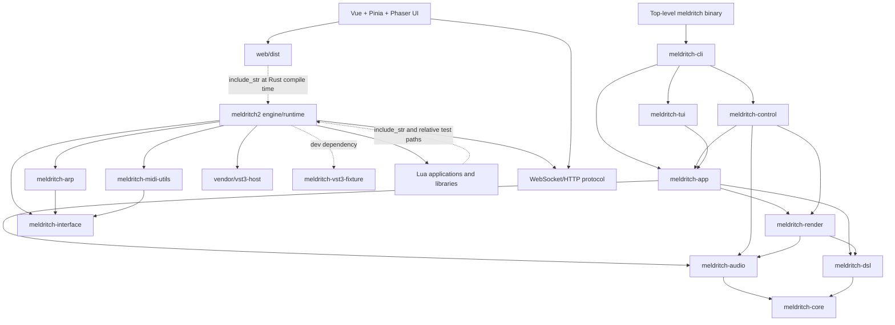

# Repository fracture inventory and migration plan

Status: proposed architecture, based on repository state at `a4308e1` on
2026-11-09. This document is the gate before any source extraction. No files
should move to another repository until the decisions and Phase A contract
work below are accepted.

## Executive summary

The active tree contains two different Rust systems:

- Meldritch 1 is still a buildable workspace graph rooted at the top-level
  `meldritch` package and eight implementation crates. It owns the historical
  `songs/`, `fixtures/`, sample asset, and most rendering/manifest scripts.
- Meldritch 2 is the default workspace member. Its engine is mostly one large
  `meldritch2` crate, but it intentionally depends on the independent
  `meldritch-interface`, `meldritch-arp`, and `meldritch-midi-utils` crates.
  The VST3 fixture is also active Meldritch 2 test infrastructure.

The three target repositories are viable without redesigning audio, sequencing,
Vue, Phaser, Lua, hardware support, or VST3 hosting. The blockers are boundary
mechanics rather than product behavior:

1. Rust embeds UI build products from `crates/meldritch2/web/dist` at compile
   time.
2. Rust tests use `include_str!` and repository-relative paths to consume Lua
   applications from both `crates/meldritch2/examples/` and top-level
   `examples/`.
3. The WebSocket protocol is hand-authored twice: JSON construction and parsing
   in Rust, and `frontend/src/types/protocol.ts` in TypeScript.
4. The Lua API is spread across an embedded Lua prelude, Rust userdata methods,
   and embedded Lua libraries. It has no version or capability manifest.
5. The large `meldritch2` crate exposes most implementation modules publicly,
   so crate/module visibility does not currently communicate a supported Rust
   API.

The recommended order is contract-first: establish machine-readable Web and
Lua contracts in `meldritch`, validate current consumers, decouple tests and
packaging, extract history-preserving UI and Lua repositories, switch the
engine to pinned release artifacts/configured application paths, and only then
remove the original copies and Meldritch 1.

## Scope and evidence

This inventory inspected:

- every workspace and package manifest;
- all tracked top-level paths and ignored/generated trees;
- Rust module and local-crate dependencies;
- public Rust declarations in each crate;
- Lua registration, userdata, include, persistence, and application paths;
- frontend source, transport, store, tests, and build configuration;
- WebSocket JSON production, command dispatch, authentication, revisioning,
  and reconnection behavior;
- build, test, documentation, capture, rendering, and hardware scripts;
- recent path history, including `efe2bbe` ("Archive Meldritch 1 and make
  Meldritch 2 the default").

Ignored build products (`target/`, `node_modules/`, VitePress output,
`artifacts/`, and captured `performances/`) were identified but are not source
deliverables. The working tree also contained pre-existing untracked
`bin/pressure-system` and `playground.sh`; they were not changed and are not
assumed to be committed migration inputs.

## Current dependency graph

### Repository-level graph



There are no local-crate dependency edges from Meldritch 2 into the Meldritch
1 implementation crates. The similarly named interface, arpeggiator, and MIDI
utility crates were added for Meldritch 2 and are active dependencies; deleting
all crates without a `2` suffix would break the current engine.

### Meldritch 2 internal dependency clusters

The `meldritch2` crate is a coarse packaging boundary containing several real
internal boundaries:

| Cluster                  | Current modules                                                     | Owns                                                                                        | Principal dependencies                                                       |
| ------------------------ | ------------------------------------------------------------------- | ------------------------------------------------------------------------------------------- | ---------------------------------------------------------------------------- |
| Graph contract and model | `contract`, `model`, inline `units`, `expand`                       | DSP module descriptors, authored graph, controls, surfaces, device preferences              | `meldritch-interface`; sequencer/sample/VST handles leak into model variants |
| Preparation and DSP      | `compiler`, inline `units`, `plaits`, `poly`, `timed`, `sample`     | validation, graph lowering, DSP state, bounded render plans, offline render                 | graph model, VST3, sequencer, MIDI interface                                 |
| Runtime and devices      | `device`, `live`, `live_notes`, `midi`, `midi_clock`, `midi_device` | CPAL callback, publication, timed MIDI, device sessions                                     | compiled machine, panel handles, sequencer                                   |
| Sequencing and events    | `sequencer`, `event_bridge`                                         | authored pattern/arrangement state, transport, persistence, UI-thread event publication     | shared synchronization and bounded queues                                    |
| Host integrations        | `vst3`, `apc`, `stream_deck`, `panel`                               | VST3 lifecycle/state, APC mapping/LED state, Stream Deck surfaces, control pickup           | compiler/model/sequencer/performance UI                                      |
| Lua host                 | `lua`, `navigation`                                                 | Lua VM, public authoring prelude, userdata capabilities, app loading and callback ownership | almost every control-side subsystem                                          |
| Presentation hosts       | `tui`, `screen_panel`, `performance_ui`, `web`                      | terminal projection, browser projection, HTTP/WebSocket server                              | model, controls, sequencer, device telemetry                                 |
| Executables              | `main`, `vst3_state_main`                                           | CLI dispatch, full lifecycle, state capture tooling                                         | all relevant host/runtime modules                                            |

This table is not a proposal to split each row into a crate immediately. A
crate split is justified only after cycles and state ownership are reduced and
the extracted API is smaller than the implementation. The existing four
first-party Meldritch 2 crates are meaningful and must remain separate.

## Ownership inventory and migration mapping

### Rust and repository infrastructure

| Current path                                                                                    | Current role                                     | Target owner | Action                                                                                                    |
| ----------------------------------------------------------------------------------------------- | ------------------------------------------------ | ------------ | --------------------------------------------------------------------------------------------------------- |
| `crates/meldritch2/` excluding `frontend`, `web/dist`, app examples, and consumer Lua libraries | Engine, runtime, host adapters, CLI              | `meldritch`  | Retain; rename the package/binary only in a separate compatibility-reviewed change, not during extraction |
| `crates/meldritch-interface/`                                                                   | Allocation-free DSP/MIDI types and module traits | `meldritch`  | Retain as the lowest-level Rust contract crate                                                            |
| `crates/meldritch-arp/`                                                                         | Host-independent realtime MIDI arpeggiator       | `meldritch`  | Retain as a meaningful crate over `meldritch-interface`                                                   |
| `crates/meldritch-midi-utils/`                                                                  | Host-independent key-lock MIDI processor         | `meldritch`  | Retain as a meaningful crate over `meldritch-interface`                                                   |
| `crates/meldritch-vst3-fixture/`                                                                | Source-built VST3 integration fixture            | `meldritch`  | Retain as test-only infrastructure                                                                        |
| `crates/meldritch2/vendor/vst3-host/`                                                           | Modified/pinned VST3 host dependency             | `meldritch`  | Retain initially; document provenance and patches, then decide upstream/git dependency separately         |
| `crates/meldritch2/vendor/lua-state-machine/`                                                   | Embedded navigation dependency                   | `meldritch`  | Retain with license/provenance; it is runtime implementation, not an application                          |
| `tools/build-vst3-fixture.sh`, VST3 capture scripts, `usb-button-capture.sh`                    | Meldritch 2 integration/hardware tooling         | `meldritch`  | Retain and remove repository-relative Lua assumptions where present                                       |
| Root Rust workspace files and toolchain                                                         | Combined workspace                               | `meldritch`  | Rewrite after M1 removal to contain only retained engine crates                                           |
| Root documentation/VitePress config and current architecture docs                               | Meldritch 2 product/engine docs                  | `meldritch`  | Retain; link to consumer repositories and published contract artifacts                                    |

### Frontend

| Current path                                                                                          | Target owner                                      | Action                                                                                                                        |
| ----------------------------------------------------------------------------------------------------- | ------------------------------------------------- | ----------------------------------------------------------------------------------------------------------------------------- |
| `crates/meldritch2/frontend/src/`                                                                     | `meldritch-ui`                                    | Extract with path history; preserve Vue, Pinia, Phaser, tests, and styles                                                     |
| `crates/meldritch2/frontend/{package.json,package-lock.json,tsconfig.json,vite.config.ts,index.html}` | `meldritch-ui`                                    | Extract; change build output to local `dist/`, add configurable engine HTTP/WebSocket base URLs                               |
| `crates/meldritch2/frontend/CONTROL_SURFACES.md`                                                      | `meldritch-ui`                                    | Extract and update to reference the versioned Web contract                                                                    |
| `crates/meldritch2/frontend/src/types/protocol.ts`                                                    | `meldritch-ui`                                    | Replace as an authoritative handwritten definition; generate or validate it from the pinned contract artifact                 |
| `crates/meldritch2/web/dist/`                                                                         | release artifact, not source owner                | Stop tracking/embedding consumer build output by source path; consume a pinned UI release bundle for packaged engine releases |
| UI-specific sections of `docs/server.md`                                                              | primarily `meldritch-ui`, linked from `meldritch` | Move development details; keep engine protocol/security semantics with the contract owner                                     |

### Lua

| Current path                                                                           | Target owner                               | Action                                                                                                                                                                 |
| -------------------------------------------------------------------------------------- | ------------------------------------------ | ---------------------------------------------------------------------------------------------------------------------------------------------------------------------- |
| `crates/meldritch2/examples/*.lua` and adjacent example docs/data                      | `meldritch-lua`                            | Extract with history; these are applications/acceptance examples, not engine implementation                                                                            |
| Top-level `examples/`                                                                  | `meldritch-lua`                            | Extract with history; despite its location, this is an active Meldritch 2 application/library corpus                                                                   |
| `crates/meldritch2/lua/musical.lua`                                                    | decision described below                   | Prefer `meldritch-lua` as a versioned reusable author library after a compatibility shim/release; it is explicitly Lua-owned musical modeling over native capabilities |
| `crates/meldritch2/lua/arp.lua`                                                        | `meldritch-lua`                            | Extract as a reusable author-side pattern library; do not confuse it with the Rust realtime `meldritch-arp` crate                                                      |
| Embedded `API` prelude and Rust userdata implementations in `src/lua.rs`               | `meldritch`                                | Retain; this is the host SDK/runtime implementation and must not be copied into the application repository                                                             |
| Lua application tests currently under `crates/meldritch2/tests/` and inline Rust tests | split                                      | Consumer behavior tests move with apps; engine conformance tests remain and run against pinned contract fixtures rather than relative consumer source                  |
| Application launch wrappers in `bin/` and app-specific docs                            | `meldritch-lua` where application-specific | Replace hard-coded monorepo paths with commands accepting/configuring the adjacent Lua checkout or an installed app path                                               |

### Meldritch 1

The following are active-tree Meldritch 1 and are candidates for deletion after
the retention audit and extraction gates pass:

| Path/category                                                                                                                                           | Evidence                                                        | Disposition                                                                  |
| ------------------------------------------------------------------------------------------------------------------------------------------------------- | --------------------------------------------------------------- | ---------------------------------------------------------------------------- |
| Top-level `[package] name = "meldritch"` and its binary mapping to `crates/meldritch-cli/src/main.rs`                                                   | Root manifest local dependencies form only the M1 graph         | Remove package section; keep a workspace-only or new engine package manifest |
| `crates/meldritch-app`, `meldritch-audio`, `meldritch-cli`, `meldritch-core`, `meldritch-control`, `meldritch-dsl`, `meldritch-render`, `meldritch-tui` | Connected local graph with no edge from M2                      | Remove from source/workspace after a final negative dependency scan          |
| `songs/`                                                                                                                                                | Referenced by M1 control/DSL/TUI tests and docs, not M2 runtime | Remove from active repository; history remains in Git                        |
| `fixtures/` and `tools/csound/`                                                                                                                         | Referenced by M1 CLI/tests/render scripts                       | Remove                                                                       |
| `assets/samples/voice/` and `tools/fetch-raven-voice-sample.sh`                                                                                         | Used by the M1 song/sample corpus; no M2 reference              | Remove after confirming no extracted Lua app elects to adopt it              |
| `tools/meldritch1-check.sh`                                                                                                                             | Explicit historical M1 check                                    | Remove                                                                       |
| M1 render/control/manifest helper scripts                                                                                                               | Invoke `meldritch-cli` and `fixtures/`                          | Remove                                                                       |
| M1-only Cargo dependencies and lock entries                                                                                                             | Reachable only from removed packages                            | Let `cargo generate-lockfile`/build prune them; review diff                  |
| Historical generated artifacts and captures                                                                                                             | Ignored local output                                            | Not source; leave user-local ignored files untouched                         |

`meldritch-interface`, `meldritch-arp`, `meldritch-midi-utils`,
`meldritch-vst3-fixture`, `examples/`, and the VST3 fixture builder must not be
removed as M1 merely because of their names or top-level locations.

## Existing boundary contracts

### Rust crate boundaries

`meldritch-interface` is already the strongest Rust boundary. It owns:

- allocation-free audio module descriptors (`Contract`, ports, parameters,
  roles, and `ProcessFn`);
- timestamped MIDI and tempo values;
- `MidiProcessor` and named-port `MidiModule` traits.

`meldritch-arp` and `meldritch-midi-utils` depend only on that interface and
provide static named-port contracts. This is intentional coupling: the host
routes events from interface contracts while processors remain host-independent.

Weaknesses to correct:

- no crate has an explicit lifecycle/error/realtime-safety contract document;
- contracts use `&'static str` errors and public concrete structures without a
  stated compatibility policy;
- `meldritch2` publishes nearly every module, making implementation visibility
  look like support commitment;
- `model::ModuleRuntime` directly contains sample, sequencer, Plaits, and VST3
  implementation handles; this intentional in-process lowering boundary should
  be documented as internal, not exported as a stable consumer API;
- the public DSP `ProcessFn` permits only convention, not types, to express
  aliasing, buffer lengths, allocation, panic, and realtime constraints.

### Rust to Lua

The public API currently consists of all of the following:

1. The embedded `API` Lua prelude in `src/lua.rs`, including `meldritch.graph`,
   `meldritch.subpatch`, `meldritch.instrument`, graph/facade builders,
   performance declarations, MIDI hooks, control surfaces, and module helpers.
2. Rust-created functions such as `meldritch.include`, `server`, `samples`,
   `vst3_plugins`, and `event_ui`, plus internal functions used by the prelude.
3. Rust userdata methods for sequencers, web servers, planes, sample banks,
   VST3 objects, UI screens, and event subscriptions.
4. The embedded `meldritch.musical` and author-side `meldritch.arp` libraries.
5. Module discovery via `_contract`, which exposes ports and default parameters
   but not a complete host capability/version description.

Current ownership and lifecycle are sound in important ways:

- one control-side Lua VM owns callbacks and mutable Lua state;
- callbacks never execute in the realtime audio callback;
- event and network queues are bounded and observational/control-side;
- the compiler prepares a graph before audio publication;
- `meldritch.include` canonicalizes paths and confines includes to the
  application's project root;
- the CLI accepts an arbitrary Lua entry file, so an adjacent or installed
  application checkout already works at runtime.

Missing contract features are an API version, capability query, complete
manifest, generated editor annotations, documented error taxonomy, and
automated agreement between manifest and registrations. Persistence is also a
contract: sequencer save data is generated Lua with version `2`, stable track
identity checks, and atomic-ish temporary-file behavior that must be captured
before extraction.

### Rust to Web UI

Current transport semantics observed in code and tests:

- HTTP serves browser configuration and static UI resources; WebSocket defaults
  to `/performance` and is bounded by message, queue, connection, and timeout
  limits.
- Authentication is an optional first-class `authenticate` message mapping an
  opaque token to a Lua-declared role. Authorization is rechecked on mutation.
- Server-to-client messages include `session`, `state.snapshot`,
  `state.updated`, and `error`.
- Client commands include `control.set`, `step.toggle`, `trigger.fire`, note
  create/update/delete, drum hit/velocity/mute, `pattern.select`, `adsr.set`,
  and `preset.select`.
- State messages carry an epoch, monotonic revision, schema revision, engine
  state, projected role-specific planes, complete authoritative values, and
  optional audio telemetry.
- Updates are complete value projections, not patches. The frontend discards
  stale revisions, resets on epoch change, clears optimistic pending values
  when authoritative state arrives, and reconnects after 750 ms.
- Rust emits `schema_version: 3`; the current TypeScript `Snapshot` does not
  require or model this field. Neither side negotiates a protocol version.
- The server sends a schema only when needed and increments a schema revision
  based on a fingerprint. State is engine-authoritative; the browser's local
  patches are transient interaction feedback.

The protocol types are not actually shared: Rust builds and parses generic
`serde_json::Value` objects, while TypeScript manually declares matching
interfaces. Tests cover behavior but cannot prevent silent field/type drift.

## Intentional and accidental coupling

| Coupling                                                            | Classification                                               | Reason/action                                                                                               |
| ------------------------------------------------------------------- | ------------------------------------------------------------ | ----------------------------------------------------------------------------------------------------------- |
| `meldritch-arp` and `meldritch-midi-utils` -> `meldritch-interface` | Intentional                                                  | Stable host-independent processor contract; retain and document                                             |
| Compiler/model/runtime modules inside one process                   | Mostly intentional                                           | Realtime path needs prepared direct data; keep implementation private and document publication boundaries   |
| Lua prelude -> private Rust `_...` host functions                   | Intentional implementation detail, currently under-specified | Treat the prelude and registrations as one engine-owned SDK implementation validated from one manifest      |
| Lua application -> public `meldritch.*` API                         | Intentional                                                  | Replace source inspection with versioned manifest/docs/annotations                                          |
| UI -> WebSocket/HTTP contract                                       | Intentional                                                  | Replace duplicate handwritten definitions with schema-driven validation/types                               |
| Rust `include_str!` -> `web/dist`                                   | Accidental repository/build coupling                         | Replace with a pinned UI release artifact or explicitly configured static directory outside audio callbacks |
| Engine tests -> top-level and nested Lua application source paths   | Accidental source coupling                                   | Move consumer tests or use versioned conformance fixtures/artifacts                                         |
| Vite output -> sibling engine directory                             | Accidental layout coupling                                   | Build `meldritch-ui/dist`; package independently                                                            |
| App launch scripts/docs -> `crates/meldritch2/examples/...`         | Accidental layout coupling                                   | Resolve an explicit app path/configurable Lua root                                                          |
| M1 and M2 in one Cargo workspace/lockfile                           | Accidental historical coupling                               | Remove M1 after retained-component audit                                                                    |
| UI store optimistic patches -> eventual full server projection      | Intentional                                                  | Specify convergence and failure behavior in Web contract                                                    |
| `model::ModuleRuntime` -> concrete host types                       | Intentional internal coupling                                | Keep private/non-contractual unless a future crate split proves value                                       |
| UI and Lua repositories -> adjacent checkout location               | Development convenience only                                 | Integration scripts may discover/configure paths, but manifests/source must not use relative dependencies   |

## Target contract architecture

Contracts should initially live in `meldritch`, because the engine is the
authoritative host and implementation changes must update and validate them in
the same review. Proposed layout:

```text
contracts/
  crates/
    README.md
    meldritch-interface.md
    meldritch-arp.md
    meldritch-midi-utils.md
    meldritch2.md
    vst3-host-adapter.md
  lua/
    api.yaml
    schemas/
    types/meldritch.lua
    README.md
  web/
    protocol.yaml
    schemas/*.schema.json
    generated/protocol.ts
    README.md
  compatibility/
    policy.md
    versions.yaml
  fixtures/
    lua-conformance/
    web-conformance/
```

Generated outputs must contain a prominent source/version header and a
reproducibility check. They should be publishable as a small release archive
without a Rust checkout.

### Rust contract documents

Create one document per retained first-party crate and a document for the
engine facade. Each must reference actual `pub` items and state:

- purpose and explicit non-responsibilities;
- owned state and mutation authority;
- allowed dependencies and dependency direction;
- construction, reset, processing, shutdown, and drop guarantees;
- `Send`/thread affinity and synchronization rules;
- error and panic behavior;
- realtime rules (no allocation, locks, filesystem, network, Lua, validation,
  or blocking in audio callbacks where applicable);
- serialization/wire commitments, if any;
- SemVer/compatibility scope.

Compiler checks remain primary. Add API-surface tests/lints where they add
signal, but do not mirror Rust types into YAML.

### Lua contract

`contracts/lua/api.yaml` should be the authoritative public host manifest. It
must model namespaces, functions/methods, arguments, results, Lua-visible
records/userdata, errors, thread/lifecycle phase, mutation authority, and
capability/version introduction. The engine should expose at least:

```lua
meldritch.host_api_version()       -- semantic API version
meldritch.host_capabilities()      -- stable capability IDs and versions
```

Generate EmmyLua/LuaLS annotations and reference documentation. Validate the
manifest against actual Rust registration and the engine-owned prelude using a
registration inventory/conformance test. Consumer tests in `meldritch-lua`
should run against a mock generated from the same manifest plus a smaller set
of engine-backed integration tests.

The public manifest must not expose private `_contract`, `_sequencer`, `_vst3`,
or similar bootstrap functions merely because they exist. Those are an
engine-internal ABI between Rust registrations and the engine-owned SDK prelude.

### Web contract

Use JSON Schema (draft 2020-12) for message payloads, wrapped by a small
`protocol.yaml` manifest defining lifecycle, ordering, authentication,
reconnection, state authority, and versions. Generate or validate TypeScript
from it. Rust should use typed serde request/response enums at the wire boundary
and validate generated schemas/examples in tests; runtime schema validation
must not enter the audio callback.

Add a required connection-level protocol version and explicit negotiation.
The simplest adequate design is:

- browser configuration advertises supported major and current minor;
- the WebSocket client sends its supported range in an initial `hello` before
  authentication/commands;
- the server selects a compatible version or closes with a structured
  incompatibility error;
- additive optional fields/messages increment minor; breaking changes increment
  major;
- epoch and revision ordering retain their current semantics;
- reconnect always performs negotiation and obtains a full role-projected
  snapshot before accepting local optimism as confirmed.

### Compatibility policy

Use independent SemVer streams for `lua-host-api` and `web-protocol`, recorded
in `contracts/compatibility/versions.yaml`. Do not tie them to the engine crate
version.

- Additive optional capabilities/fields and new command variants are minor
  changes when old consumers can ignore them safely.
- Removing/renaming fields or capabilities, changing types/meaning/authority,
  or strengthening required behavior is a major change.
- Deprecations are additive, documented with replacement and earliest removal
  major; no bespoke framework is needed.
- Patch releases clarify docs/schemas or fix implementations without changing
  accepted valid messages/API shapes.
- Consumers pin an exact released contract artifact in lock metadata and test
  their supported range.
- Upgrade order for a breaking change is: publish engine supporting old+new
  where feasible, publish/migrate consumers, then remove old support in the next
  engine major. If dual support is unsafe, compatibility validation must fail
  before release and the coordinated order must be explicit.

## Contract distribution recommendation

Keep contracts in `meldritch` initially and publish two standalone release
artifacts:

- `meldritch-web-contract-VERSION.tar.zst` containing schemas, manifest,
  generated TypeScript, fixtures, and checksums;
- `meldritch-lua-contract-VERSION.tar.zst` containing the manifest, generated
  annotations/docs, mock metadata, fixtures, and checksums.

Consumers pin the artifact version and checksum in repository-local metadata.
Local adjacent-checkout development may override the artifact path explicitly,
but CI must test the pinned artifact to prevent invisible coupling.

A fourth `meldritch-contracts` repository is not recommended now. It would add
release coordination before contract review/history has stabilized and would
separate authoritative host changes from their implementation. Reconsider it
only if contracts gain independent maintainers/release cadence, multiple engine
implementations, or access controls that cannot be served by published
artifacts. Moving later is history-preserving and does not change artifact
identity.

## Independent repository development model

The supported checkout layout is:

```text
workspace/
  meldritch/
  meldritch-ui/
  meldritch-lua/
```

No manifest or source import may assume this layout. A small integration
orchestrator in `meldritch` may accept `--ui PATH`, `--lua PATH`, or environment
overrides, verify pinned contract metadata, and launch/build components. It
must not run in an audio callback or load Git repositories at runtime.

- UI-only loop: install dependencies once, run Vite against a configured
  engine URL or captured contract fixtures, lint/typecheck/test/build without
  Cargo.
- Lua-only loop: run Lua formatter/linter/unit tests against the generated mock;
  point an already-built engine binary at an application entry path for
  integration, without rebuilding Rust.
- Rust-only loop: run targeted package/module tests using contract conformance
  fixtures, without Node or the live Lua consumer checkout.
- Full integration: obtain committed/pinned revisions of all three repositories,
  verify contract version ranges/checksums, build release artifacts from clean
  trees, run the engine with the selected Lua app and UI bundle, then execute
  protocol, persistence, hardware-simulation, and lifecycle tests.

The engine should support a configured static UI directory for development and
a pinned UI release bundle for distributable packages. It must never fetch UI
or Lua source from the network during startup. Lua application discovery should
be an explicit CLI/config search path containing application manifests; direct
entry-file invocation remains supported.

## Bounded migration sequence and validation gates

Each numbered item should be one or more small commits with a green gate. Do
not combine extraction, protocol redesign, and M1 deletion in one commit.

### Stage A: baseline and contracts

1. Record baseline commands, representative app hashes/renders, Web fixtures,
   persistence fixtures, and hardware simulated shutdown state. Gate: current
   Rust/UI suites pass without changing behavior.
2. Add crate contract documents for the retained Rust crates and reduce only
   clearly accidental public visibility. Gate: rustdoc/build/tests and an
   explicit public-interface review.
3. Add Web contract schemas matching current version 3 behavior, typed Rust
   wire enums, generated/validated TypeScript, and golden conformance messages.
   Gate: current UI and engine pass against the same schema; deliberately
   incompatible fixtures fail.
4. Add Lua API manifest, capability/version query, generated annotations/docs,
   registration validation, and mock metadata. Gate: existing Lua corpus loads
   under the declared version and a removed/changed capability fails clearly.
5. Publish reproducible local contract archives and checksum metadata. Gate:
   unpacked artifacts validate with no Rust source checkout.

### Stage B: remove source-layout coupling

6. Change UI build output to its own `dist/` and configure engine endpoint/base
   paths. Add fixture/mock transport for UI-only work. Gate: UI test,
   typecheck, lint/format, and production build run from the frontend directory
   with no Cargo invocation.
7. Replace engine `include_str!` dependency on sibling UI output with explicit
   static asset packaging/configuration. Gate: engine builds from a checkout
   containing no frontend source; packaged UI still serves and connects.
8. Divide Lua tests into engine contract fixtures and consumer application
   tests; remove Rust compile-time includes of consumer paths. Gate: engine
   tests pass without application source, and consumer tests pass without Rust
   source.
9. Add app manifests with required Lua API range, entrypoint, libraries/assets,
   and optional integration requirements. Gate: engine loads apps from an
   arbitrary external directory and rejects incompatible API requirements
   before mutation/audio startup.

### Stage C: history-preserving extraction

10. Create local `meldritch-ui` with filtered path history, then add the
    independent manifest/config/contracts/CI changes as normal commits. Gate:
    clean clone install, test, typecheck, lint/format, build, and fixture-backed
    protocol tests.
11. Create local `meldritch-lua` with filtered history from both Lua corpora and
    Lua-owned libraries. Gate: clean clone lint/unit/mock tests plus engine-backed
    app loading from a non-adjacent temporary path.
12. Add cross-repository integration lock metadata and orchestrator. Gate: a
    reproducible clean integration workspace checks out exact commits and passes
    contract compatibility plus full startup/shutdown.
13. Only after the extracted repositories are independently verified, remove
    original frontend and Lua consumer source from `meldritch`. Gate: the engine
    repository still builds/tests with only pinned contract/conformance/UI
    artifacts.

Use `git filter-repo` or an equivalent local history-preserving export into new
repositories. Do not rewrite the existing shared repository. Remote creation
and pushes require separate authorization; local repositories can be completed
and reported if credentials are unavailable.

### Stage D: Meldritch 1 removal

14. Run a final retained-component scan and archive a deletion manifest in this
    document. Remove M1 workspace members/root package, sources, songs, fixtures,
    scripts, obsolete docs/references, and dependencies in reviewable groups.
15. Regenerate/prune the Rust lockfile and update CI to run retained engine crate
    targets and contract validation only. Gate: searches find no active M1
    package/path references, `cargo metadata` contains only retained crates, and
    the engine builds/tests independently.

History remains available in existing commits; do not retain an active
`archive/` source subtree merely to avoid deletion.

### Stage E: release and system validation

16. Produce committed, clean-tree candidate revisions and contract artifacts
    for all repositories. Tag artifacts with exact commit IDs, never `dirty`.
17. Run automated full-system scenarios: app load, UI negotiation/snapshot and
    commands, sequencer/persistence round trips, simulated MIDI/APC/Stream Deck,
    VST3 fixture lifecycle/state restore, malformed/incompatible contracts,
    reconnection/resynchronization, and clean shutdown.
18. Run hardware/plugin/manual gates on the supported host: physical MIDI,
    Stream Deck, APC, native plugins (including state restoration), listening,
    realtime underrun/latency observation, and stale LED/note cleanup.

The migration is complete only when the required physical/plugin gates are
recorded as passed or explicitly identified as release blockers; unit tests
must not be presented as physical verification.

## Validation matrix

| Requirement              | Automated gate                                                     | Manual/host gate                               |
| ------------------------ | ------------------------------------------------------------------ | ---------------------------------------------- |
| M1 absent                | Cargo metadata/path/reference negative checks                      | None                                           |
| Rust independent         | Clean engine clone build, clippy, tests, contract packaging        | Audio backend smoke test                       |
| UI independent           | Clean UI clone install, test, typecheck, lint/format, build        | Browser interaction and Phaser surface review  |
| Lua independent          | Lint/unit/mock/manifest checks without Rust source                 | Edit/reload live app without engine rebuild    |
| External Lua loading     | Temporary non-adjacent app path integration                        | Application selection workflow                 |
| Web contract             | Schema golden/negative tests, negotiation matrix, reconnect tests  | Multi-browser role session                     |
| Sequencer behavior       | Existing sequencer/groovebox/render/persistence fixtures           | Listening/performance comparison               |
| Phaser controls          | Component/gesture/domain tests, production build                   | Pointer/touch/keyboard/responsive review       |
| MIDI                     | Simulated timestamp/routing/reset tests                            | Physical input/output                          |
| Stream Deck/APC          | Simulated frames, reconnect, shutdown-black tests                  | Physical reconnect and stale-state check       |
| VST3                     | Source fixture discovery/process/state/crash tests                 | Supported real plugins and native editor/state |
| Persistence              | Golden round trips and incompatible version tests                  | Existing project reopen                        |
| Contract incompatibility | Deliberate major/range/schema failures in each consumer CI         | None                                           |
| Full lifecycle           | Process start/stop and resource/port cleanup test                  | Audio/MIDI/hardware clean exit                 |
| Realtime safety          | Callback-focused tests, allocation/lock review, underrun telemetry | Sustained load and underrun observation        |

## Architectural decisions requiring approval

1. **UI distribution.** Recommend independent UI releases plus an optional
   pinned bundle in engine distribution packages, while development uses a
   configured static directory/Vite server. This preserves the one-command
   product without restoring source-level coupling. Alternative: engine never
   serves UI and deployments always host it separately.
2. **Lua library ownership.** Recommend moving `musical.lua` and author-side
   `arp.lua` to `meldritch-lua`, with explicit library versions and a temporary
   engine compatibility bundle. The engine retains the host prelude and Rust
   bindings. Alternative: declare these two files part of the engine SDK and
   publish them with the Lua contract artifact.
3. **Protocol negotiation envelope.** Recommend adding a small mandatory
   `hello` negotiation before authentication/commands rather than relying on
   the currently unconsumed `schema_version` field.
4. **Engine package naming.** Recommend deferring rename of crate/binary
   `meldritch2` until after fracture. Repository ownership does not require a
   simultaneous executable rename, and preserving commands reduces migration
   risk.
5. **Fourth contracts repository.** Recommend no fourth repository initially;
   publish standalone artifacts from `meldritch` and reassess after stable
   independent releases.
6. **Further Rust crate splits.** Recommend retaining the four current
   first-party M2 crate boundaries during fracture. After contracts and
   visibility are explicit, evaluate extracting a smaller engine facade,
   sequencer, or Web protocol crate only when dependency direction is acyclic
   and the public surface is demonstrably smaller. Do not split by filenames.

Decisions 1 and 2 affect packaging and extraction contents and should be
approved before Stage B. Decisions 3 through 6 can proceed with the
recommendations unless product/release constraints require another choice.

## Immediate next checkpoint

After approval of the decisions above, the next implementation checkpoint is
Stage A only: baseline fixtures, crate contract documents, current-behavior Web
schemas/types, and the Lua manifest/capability inventory. It should not move UI
or Lua application files and should not remove Meldritch 1. That checkpoint
will make later extraction reviewable and allow compatibility failures to be
detected before consumers leave the repository.
