# Meldritch 2 architecture diagrams

The Mermaid sources are committed beside their rendered SVGs so the diagrams
remain reviewable, editable, and reproducible.

## MIDI crate and module layout

Source: [`midi-crate-layout.mmd`](./midi-crate-layout.mmd)

## Full browser, Lua, and Rust architecture

Source: [`system-architecture.mmd`](./system-architecture.mmd)
